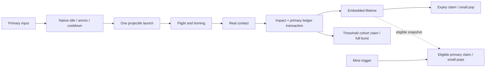
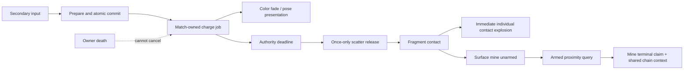

# Crystal weapon: source-bound modular graph plan

2026-10-12, SHADOWBANE, canonical checkout; design owner
`codex-pd-local-cue-20261010`, Workbench **N-0575 / T-MODDING-011**.
This is a complete behavior/extension plan with explicit unresolved policies,
not an executable asset, tuning approval, implementation assignment or runtime
verdict. Parent owns visual references, decisions and integrated review.
The existing thirteen-file graph freeze and retained-native gates remain intact.

The destination now includes base weapons and ultimately all gameplay through
reusable typed graphs over efficient native operations, with **stock native
behavior preserved**. The packet's `base-weapon-migration-plan-v1.md` and
`gameplay-function-catalog-plan-v1.md` extend this plan with actual source inventory,
function-derived catalog classes, exact incremental owners and differential
parity gates. Their candidate lexical index is not exhaustive semantic coverage;
no giant rewrite, new writer or completed stock migration is claimed here.

## Fixed behavior and open choices

Latest capacity direction: Mike allows **two laptop slots per owner** and wants
mine caps scaled by player count, beyond the original N64 multiplayer limit.
The owner allowance is distinct from the global deployed-device pool. Active
match slots, connected clients, bots, shared proximity capacity and replicated
reservations require separate limits; no proposed higher total is tested.
See [device-cap-direction-20261012.md](../../../.claude/pd-weapon-scatter-graph-plan-20261012/device-cap-direction-20261012.md)
for the count-change, simultaneous-deployment, reclaim, save/restore and server
limit proposals and qualification gates. `device-cap-bindings-v1.json` preserves
the initial capacity amendment's historical source/document snapshot; current
consultation/reconciliation documents are bound by `claude-cap-response-binding-v2.json`.
V9 is the historical preimplementation binding, preserved separately. Per-player mine numbers and bot/count
semantics remain open. Component/runner/observer cohorts remain first; exact
runtime/network owners and graph13 are preserved. This capacity feature needs
its own acceptance beside native-equivalent stock graph migration.
The actual anonymous Claude deployable-cap consultation has been read locally
and reconciled in the packet's `claude-deployable-cap-reconciliation-v1.md` and
`claude-cap-response-binding-v2.json`. Separate two logical owner slots from
retiring physical headroom; make global/family reservations atomic across
owners; preserve prepared versus irrevocable commit and exhausted causal-root
budgets across deferred ticks. Third-laptop behavior, roster/count/bots/grace,
numeric mine formula and orphan/transfer/restore policies remain open. No new
Claude request, deployable implementation or runtime acceptance follows.

The selected secondary is **scatter mines**. Secondary fragments never add to
primary accumulation. A secondary crystal directly hitting a character causes an
**immediate individual explosion**. Whether that explosion also triggers embedded
primaries remains OPEN. A mine triggering embedded primaries below threshold causes
**individual small pops**, without reapplying their original impact damage.
The full burst remains the primary accumulation reward. Do not reopen marking
secondary or below-threshold full-combo proposals.

Primary crystals track, impact, embed and eventually expire with a small pop.
Their seafoam appearance, vibrant green/blue burst and yellow/neon-green secondary
charge are the current visual direction. Slower fire/projectiles and stronger
tracking are design intentions, not approved parameter values. A short committed
secondary charge fades color, cannot cancel, and **must release at its deadline
after owner death**. Surface mines require an arming delay/tell. No implicit
owner-death cleanup may cancel the committed release.

Use symbolic values throughout: threshold `N` (five is an earlier draft), charge
duration `Tcharge`, embedded lifetime `Tembed`, arming time `Tarm`, mine lifetime,
loaded-ammo/fragment relation, caps, damage, steering and radii. All numeric tuning,
cross-owner grouping, world-radius behavior, direct secondary contact also
triggering primaries, shield/headshot rules and lifecycle policies remain open.
The mine one/two/three-hit and separate explosive-round balance ideas remain
provisional; the latter is outside this weapon plan.

## Actual current capabilities

The source manifest is
`../../../.claude/pd-weapon-scatter-graph-plan-20261012/source-bindings-v9.json`.
It binds the dirty source inputs, current archive and the existing graph freeze;
HEAD alone does not qualify them. Relevant anchors:

- **S1:** `port/src/weapon_graph_v2.cpp:233-340`: strict v2
  `held_single_shot.v1`, explicit event roots/ports, acyclic reachable topology;
  only hitscan action, pressed/native-ready-held events, cooldown/ammo gates and
  boolean state set/gate. `compileAction`/`wgV2NativePrepare` accept only
  `og.fire.hitscan` module version 1.
- **S2:** `port/src/weapon_graph_v2_ingress.cpp:62` rejects variables, shared
  context and presentation bindings; `weapon_graph_v2_catalog.cpp:73-83` rejects
  network, bots and Theater. These restrictions must remain until each supported
  profile has its own admission and evidence.
- **S3:** `weapon_graph_v2_runtime.cpp:165-230,398` binds action liveness to a
  living current hand/source and retires a dead owner's hand. `wgV2Cancel` and
  `weapon_graph_v2_owners.cpp:Slot::retire` cancel outstanding work. A committed
  post-death volley therefore cannot be implemented as another hand-local wait.
- **S4:** `port/src/weapon_graph_runtime.c:s_modules` has v1 spawn, homing,
  sticky attachment, timer, impact, transition, armed/proxy/sticky-device/cleanup
  names. `weaponGraphRuntimeRegisterProjectileIrOwned` and
  `weaponGraphRuntimeRegisterEntityIrOwned` fold nodes into native adapter records;
  node presence is not proof of event/dataflow execution in v2.
- **S5:** `src/game/propobj.c:projectileApplyGraphRuntime/projectileTick` has
  graph homing flags/gains, contact/stick/expiry seams. `weaponTick:5813-5888`
  has proxy arm/filter logic, but timed and proxy records share `timer240`, the
  timed branch wins, and its comment explicitly limits the widened filters to
  the current-player path. Do not claim general authority proximity semantics.
- **S6:** `port/include/pdgui_weapon_graph_node_editor.h` has 48-node/96-edge
  editor storage, 512-byte parameter strings and edges with only from/to.
  `pdgui_menu_moddinghub.cpp:weaponGraphBuilderSyncJson` emits v1 graphs and
  untyped from/to edges. The canvas is not a v2 multi-port roundtrip editor.
- **S7:** `effect_graph_runtime.h`, `effect_instance_runtime.c` and
  `effect_gameplay_runtime.c` already provide public effect programs, retained
  instances and native bridges. Reuse them; no parallel effects executor.
- **S8:** `port/include/net/net.h:13` is protocol 61; `net.c` calls the v2 use
  guard. Existing prop/character damage and reconnect-projectile handlers in
  `netmsg.c` are integration seams, not this weapon's serialized crystal ledger.

The actual `dev-mods/needler` 0.4.4 archive SHA256 is
`29c7c2fa195060724400da265cf1e48df1d0f3b93f382c62688f10534188daf8`.
Its primary is v1 trigger -> projectile spawn -> powered motion/homing; its
secondary is v1 projectile contact explosion, consume-on-hit true, stick false.
Its old damage/speed/cadence values are historical inputs, not selected tuning.
It has no accumulated-crystal threshold, scatter mine or committed charge.
V-009 historical peer/viewmodel/effect receipts and the later 94/101 missing-effect
failure remain distinct from dirty v2 source-only evidence and this new plan.

## Behavior-to-graph map

“Reuse” means an existing seam/adapter, not positive v2 execution support.
Candidate names below are proposed reusable contracts; do not publish them as
implemented node catalog entries. Retain the current profile unchanged and add a
separately versioned persistent-projectile profile after review. Its exact profile
and cross-family schema version names remain to be chosen.

| Behavior | Existing source to reuse | Required graph extension / typed result |
| --- | --- | --- |
| Press/held cadence | v2 pressed/native-ready-held, cooldown/ammo gates (S1) | Bind primary cadence to simulation/native idle; one accepted shot identity and one ammo owner. |
| Primary launch | v1 `spawn.fired_projectile`, native fired creation (S4/S5) | Promote into executable typed action with retained projectile source and `ProjectileHandle`, launch receipt and failure port. |
| Homing | v1 `projectile.motion/homing`, latched gains (S5) | Executable flight module with target-generation handle, authored acquisition/loss/retarget policy and bounded steering; no identity bypass. |
| Contact classification | native motion/contact (S5) | `projectile.contact` emits one immutable contact ID, kind, target/support generation, hit part, point and normal; actual collision only. |
| Character embedding | `projectile.sticky_attach`/native embed seam | Captured local attachment transform and target generation; separate primary ledger admission, impact receipt and attach failure. |
| Embedded expiry | `projectile.timer` adapter | Separate simulation deadline, not a shared mine arming timer; atomic terminal claim -> small pop once. |
| Same-target threshold | v2 boolean state is insufficient | Typed bounded attachment ledger and atomic cohort operation, e.g. `ledger.hit_commit` / `ledger.consume_set`; stable distinct PRIMARY IDs only. |
| Secondary admission | pressed/ammo/cooldown gates; old `fire.charge_release` is Mauler adapter | `job.commit_deadline`: prepare all resources, then one ammo/identity commit transferring an irrevocable job to match-owned service. Do not reuse trigger-release semantics. |
| Charge/color fade | existing effect/material presentation machinery (S7) | `presentation.curve` subscribes to committed job time/phase; cosmetic only, with audio/shape state cue. Renderer cannot own release. |
| Scatter release | native projectile launch seam | `spawn.scatter_volley`: one authoritative seeded, versioned fan, stable fragment indices, atomic release receipt; all fragments carry secondary role. |
| Post-death release | current hand retirement cancels (S3) | Match-owned committed job independent of pawn/hand; source lease, shooter credit and deadline survive owner death. Origin policy is required but unresolved. |
| Direct character contact | v1 contact explosion | Required immediate individual secondary explosion, exactly once; zero primary accumulation. Whether it additionally triggers embedded primaries remains OPEN. |
| Surface mine | sticky + transition-to-entity adapters | Flight -> attachment -> unarmed entity transfer with one surviving identity and no duplicate carrier/entity damage. Support-generation/local-transform tracking. |
| Arming and proximity | `entity.armed_explosive/proxy_trigger/sticky_device` (S5) | Distinct arming/lifetime clocks, complete authority query/filter route, line-of-sight/support policy, once-only trigger ports. |
| Mine-to-primary effect | no current ledger/proxy composition | Eligible primary snapshot -> atomic consume -> one small pop per claimed crystal below N. Secondary never adds a mark. |
| Full threshold burst | effect explosion bridge exists (S7) | Atomic selected primary cohort -> once-only full-burst damage/effect receipt; no expired or previously consumed crystals reused. |
| Cross-volley chains | no current shared chain transaction | `chain.enqueue` with root context inherited across all descendants/volleys, visited IDs and finite shared work/depth/radius/energy policy. |
| Removal/lifecycle | native free/retire and catalog generation leases | Typed terminal reasons, subscription invalidation and receipt retention; owner death is not permission to cancel a committed job. |
| Ammo/net/save/editor | native ammo, network/save and v1 editor seams | Explicit contracts below; all are extension/qualification work, not ready node wiring. |

## Event, state and lifetime ownership

Separate **held input**, **committed job**, **flying fragment**, **embedded primary**,
**surface mine**, **target life** and **chain root**. Do not store every state in
the hand's boolean table or keep raw pawn/prop pointers as durable identity.

| Record | Owner / identity | State and release contract |
| --- | --- | --- |
| Held input | existing hand generation/source lease | Pending press can disappear on release/retirement. It cannot cancel an already committed secondary job. |
| CommitJob | match authority; `match_epoch, attack_id` | Prepared -> committed -> materializing -> released -> terminal. Immutable commit time/deadline, ammo receipt, source/dependency hashes, seed, reserved fragment IDs/capacity, shooter credit and origin policy. Released requires complete materialization receipts, not just a claimed flag. Death cannot cancel committed work. |
| Projectile | match authority; `attack_id, fragment_index, generation` | Flight -> contact outcome -> transferred/consumed/expired. Duplicate contacts are ignored by event ID. PRIMARY/SECONDARY role is immutable. |
| EmbeddedPrimary | target-life generation plus chosen group key | Live -> claimed(reason, transaction) -> terminal; attachment and deadline, paid impact receipt. Consumption permanently removes eligibility. |
| SurfaceMine | entity generation/support generation | Unarmed -> armed -> triggered/expired/destroyed/support-lost -> terminal. Separate arm and lifetime deadlines. Numeric caps/removal policy undecided. |
| TargetLedger | match authority; stable target-life/group key | Bounded distinct primary IDs and transaction version; no stale respawn/address reuse. Cross-owner key policy is OPEN. |
| ChainContext | root trigger ID in match authority | One shared visited set and monotonic remaining work/depth/energy budgets; descendants never mint a replacement root budget. |
| Presentation | effect/material instance generation | Reads phase/time and immutable references; no authority to debit ammo, arm, consume or deal damage. |

All handles carry their lifetime/generation and exact retained source closure.
Use explicit lifetime domains and allowed transfers, not a universal linear
Job/Fragment/Mine/TargetLife order: fragments and mines may outlive their job.
Transfers use copied snapshots or retained leases and generation-checked handles
with declared dead-handle behavior. Public source identity remains catalog ID
plus source/dependency hashes and generation; no replacement asset GUID contract.
Retiring an authored source blocks new admission but must not silently invalidate
an irrevocable committed job or its already spawned objects. Their dependency
leases need independent release when those objects reach a policy-defined terminal
state. Stage/end-match/disconnect behavior is unresolved; keep that implementation
held rather than treating stage cleanup or end-match discard as an approved exception.

Candidate executable flows:

The dotted arrow supplies eligible live records to the mine-trigger transaction;
all terminal paths arbitrate at the ledger service. Graph event edges remain
acyclic within an activation; asynchronous event subscriptions and bounded timers
provide repetition without a free unbounded loop.

The immediate individual secondary explosion on character contact is required by
the latest Mike/parent clarification. Additional triggering of embedded primaries
remains a separate open choice; existing v1 behavior is source context, not the
authority for that decision.

## Atomic consumption, ordering and damage qualification

Use one authority transaction service; a general “set bool then explode” graph
is insufficient. The ledger/terminal operation prepares an immutable effect and
damage plan, reserves necessary bounded resources, claims eligible IDs once,
publishes a transaction receipt, then materializes its side effects idempotently.
No receipt may authorize both expiry and proxy pop, nor a small pop plus a full
burst for the same crystal. Retry retains the same transaction/receipt identity.

Primary contact deduplicates `contact_id`, resolves exact target generation,
accounts the actual impact including the Nth impact, inserts the accepted live
primary and evaluates threshold in an ordered transaction. Invalid attachment
must have an explicit impact-only/blocked outcome; no half-created mark or invented
refund. Full burst atomically claims its authored eligible cohort; expired/claimed
IDs do not count. If more than N are possible, excess treatment is a policy choice.

Recommended ordering for review: stable authority simulation step plus event
sequence; resolve each contact/expiry/proxy transaction serially, revalidate the
ledger version and route only the winning receipt. The exact simultaneous-event
priority, threshold-equality/excess and expiry-boundary rules remain OPEN. Do not
smuggle a tie-break default into authoring. Test all specified event orders and
require once-only damage irrespective of which permitted outcome wins.

For initially full health `H0`, primary preburst accounting includes **all prior,
current and Nth impacts plus impacts/pops from already expired crystals**. For
every reachable qualified prefix, paid damage `P` plus still-payable nonburst
damage `Q` must satisfy `P + Q < H0`. No health reset at an accumulation window.
If a finite history bounds C impacts and X paid **plus still-payable** small-pop
liabilities at every prefix, its conservative envelope is
`C * Imax + X * Emax < H0`, with actual headshot/shield/range modifiers included.
X cannot mean only pops already executed while omitting Q. Preserve requested,
evaluated-before-health-clamp and applied/clamped amounts in distinct receipts;
qualification uses worst-case unclamped liabilities under the selected rules.
C and X, history eligibility and health/shield assumptions are unselected.

Positive nonburst damage cannot stay sublethal for infinitely many failed cycles.
Two coherent decision options are a stated finite-history guarantee or a true
per-target-life nonburst damage cap/saturation policy. The latter changes gameplay;
neither is selected here. External damage, healing, respawn, cross-owner pooling
and shield bypass must be explicit qualification assumptions/policies. A fresh
ledger/window cannot erase paid history. Small pops never repay initial impact.

Each mine/contact/full-burst/small-pop damage application has a distinct damage
kind and immutable receipt ID. Shared root chains carry `(root_id, visited_ids,
remaining_work, remaining_depth, remaining_energy, query_policy)` across volleys;
processing another mine never replenishes these budgets. Explicit derived events
inherit the existing root across volleys. Reject an automatic fresh root for
movement/proximity merely because causality passed through knockback: it can refill
the budget. Independent causes, physics-mediated/unknown causality and competing
root arbitration remain OPEN. Bound spatial visits, candidate collection/buffer
memory and sorting work before materializing query results, within the root's
shared budget; sort-all then truncate does not bound collection. Snapshot a bounded
candidate subset, apply the selected deterministic order and revalidate terminal
state. Deterministic subset/filter-versus-cap and overflow/continuation policies,
all caps/radii/cross-owner rules remain for decision.

## Ammo, origin, authority, network, save and cleanup

**Ammo proposal:** snapshot only the currently loaded magazine at commit and debit
that budget exactly once in the same transaction that creates the persistent job;
no reserve or free fragments. Fragment count/distribution must be a selected
function of that snapshot. Empty/partial magazine, dual-hand/shared ammo, reload
and pickup races require explicit policies. Commit-time debit is a recommendation,
not approval; release-time debit would require protected escrow that survives
death/drop and cannot be consumed by another action. No graph gate itself debits
ammo; the native authoritative commit operation is its sole owner. Preallocate or
reserve the complete finite volley before accepting an uncancellable job so later
capacity refusal cannot silently cancel a promised release.

**Release materialization:** reserve stable fragment IDs, launch capacity, source
closure and a total selected origin path before irrevocable commit. At the deadline,
atomically publish the release plan/outbox and materialize each fragment idempotently
by its stable ID; released/terminal requires receipts for the complete promised
volley. Restore/retry resumes unfinished materialization rather than suppressing it
because a Released flag exists. Eventual retry alone does not satisfy the physical
deadline: admission must prove a capable release path before committing. Inject
interruptions before/after the claim, each fragment and receipt, including restore;
separate complete materialization from duplicate suppression. Production persistence
and lifecycle policies still need selection before this contract is connected.

**Origin proposal:** capture valid muzzle/weapon pose and bounded origin history
at commit, prefer the existing dropped weapon's authoritative pose when released,
then last valid pose, then commit pose. All are proposed; exact world obstruction,
missing support, death/drop/switch/pickup, team changes and credit behavior need
selection. Persistent credit uses stable participant identity rather than a freed
pawn. A visual charging weapon disappears without cancelling the authority job.

**Clock proposal:** use authoritative simulation ticks and an integer deadline;
cosmetic fade interpolates phase, never drives release. Deadline means release on
the first eligible authority step at/after the selected deadline, exactly once.
Whether pause continues real time or stops simulation, save/load preserves remaining
time, and a stage/end-match boundary waits or transfers work is OPEN. A death on
the deadline must not erase the release. Disconnect/end-match discard is unapproved.

**Authority:** offline simulation is the sole writer locally; listen-server
simulation is the sole network writer. Clients can predict presentation with an
uncommitted token, but cannot mint authoritative crystals, ledger marks, mine
triggers, damage or terminal claims. Distinguish player/participant/network IDs,
local slots, target generations and catalog IDs. Bots are a separately qualified
owner class, not enabled by removing the current v2 guard.

**Network extension:** reuse the current reliable event/reconnect transaction
infrastructure after exact net-owner reconciliation. Versioned messages/snapshots
need source closure, match epoch, attack/fragment IDs, commit/deadline/seed/ammo
receipt, contact/attach support and local transform, mine phase/deadlines, terminal
transaction/damage kind, chain context and stable attribution. Bound counts and
bytes, reject unknown/contradictory generations, deduplicate delayed/reordered/
duplicate events and preserve retry identities. Reconnect restores state without
relaunching a volley or replaying paid impact/pop damage. The existing protocol61
and damage/projectile snapshots do not establish these contracts; any wire change
requires a coordinated version and compatibility policy. Retain the network guard
until listen/peer late-join/reconnect evidence exists.

**Save/Theater:** archive editing/reopen is authoring roundtrip; it is distinct
from saving live jobs/ledgers/mines. Proposed runtime snapshots serialize typed
state, generations, selected policies, source closure and outstanding receipts,
never raw pointers or a second authored runtime representation. Restore is
prepare/validate/commit with size/version/corruption bounds and no duplicate
effects/damage/release. Pause, disconnect, save and end-match policy selection
precedes implementation. Theater records authoritative events/outcomes and chosen
clock semantics; replay presentation cannot run gameplay damage. Keep its existing
v2 guard until an independent reconstruction/seek/restart cohort passes.

**Cleanup:** terminal object removal is required gameplay behavior, not filesystem
cleanup authorization. Unsubscribe callbacks before native storage reuse, detach
attachments by exact support/target generation, release source leases only after
owned jobs/entities/effects terminate and retain incomplete receipts on failure.
No implicit player-death sweep of committed jobs/mines. Mine expiry, destroyability,
support removal and cap admission/oldest eviction are explicit proposed policies;
eviction must not be implemented as an unapproved damaging pop. No artifact deletion.

## Public schema, editor and roundtrip contract

Keep authored weapon/projectile/entity/effect/material/mesh sources in public
typed archives, referenced by catalog IDs. Programs/IR/native products remain
source-hashed rebuildable cache. Do not add opaque `.bin`, numeric public asset
references, duplicate hand-authored runtime files or ROM fallback.

The proposed profile needs typed event payloads/data ports and scoped state, not
just untyped exec edges: projectile/contact/target/support handles, commit job,
deadline, immutable source lease, ledger snapshot/claim receipt, damage receipt
and chain context. Define per-module version, required/optional parameters, units,
finite ranges and resource cardinality. Never infer lifetime from a variable name.
Validate all branches/dependencies before admission, including never-selected ones.

Reject unknown executable modules/versions, ambiguous exports, missing lifetime
bindings, type/port mismatch, cycles/unbounded loops, duplicate IDs/edges, forged
secondary-to-primary ledger paths, multiple ammo owners, reinitializing child chain
roots, unsupported use contexts and explicit unresolved required policies. Editor
may retain an unsupported source read-only for inspection but must not silently
convert it to v1 or discard ports/parameters/context on save. Preserve absent versus
explicit zero and false. Validate integer/float units/overflow, Unicode escaping,
catalog reference type and complete archive dependency closure.

Extend `PdWeaponGraphNodeEdit/EdgeEdit` and editor load/save/undo/copy-paste to
retain schema/profile/module versions, event/data pin names/types, scopes, policy
records, both-mode roots and stable IDs. Replace or explicitly validate current
48/96/512 limits; PC authoring does not justify silent truncation. Central module
descriptors should drive compiler validation and editor forms so a listed node
cannot promise unsupported execution. Keep UI layout metadata separate from
behavioral source identity/semantic hash; exact byte source identity still binds
compiled caches. Save/reopen/edit must preserve executable topology and all
parameters, with clean validation errors on unsupported/incomplete plans.

## Exact extension surfaces and cooperative ownership

Current N-0575 owns only this new plan and its packet. The existing graph13 owner
is the same coordinator under N-0477/N-0479/N-0533; this does **not** expand its
held-single-shot assignment. Pipeline `codex-f9571c12-6af53c63` retains
T-MODDING-009 / graph-runtime umbrella responsibility, and former Tooling
`01a0f5c1-d031-77b0-a372-3391765df0d5` retains T-MODDING-010's inventory/editor
coordination boundary. T-MODDING-003 being unassigned is not an asset release.
T-NETWORKING-011 has the current coordinator as item owner; exact net file hunks
still require live cooperative assignment, not inheritance from that item title.
T-THEATER-001 remains a separate owner. No owner record is cleared by this plan.

| Future coherent cohort | Existing exact files / proposed new files | Before editing |
| --- | --- | --- |
| Generic persistent executable profile and state/events | `port/include/weapon_graph_v2.h`, `port/src/weapon_graph_v2.cpp`; `weapon_graph_v2_native.{h,cpp}`, `weapon_graph_v2_ingress.{h,cpp}`, `weapon_graph_v2_equipped.{h,cpp}`, `weapon_graph_v2_catalog.{h,cpp}` | Reconcile Pipeline plus graph owner; separately claim profile/compiler/action/public-source validation hunks. Preserve existing held profile/admission/tests. |
| Persistent job and typed ledger/chain service | Proposed new `port/include/graph_persistent_actor.h`, `port/src/graph_persistent_actor.cpp`, focused tests; integrate `weapon_graph_v2_runtime.{h,cpp}`, `weapon_graph_v2_owners.{h,cpp}`, `weapon_graph_v2_gset.{h,cpp}` | Names are proposals, not allocated modules/files. One accountable lifetime-service writer; graph13 runtime/header frozen until an explicit next cohort. |
| Projectile/entity adapters and authoritative callbacks | `port/include/weapon_graph_runtime.h`, `port/src/weapon_graph_runtime.c`, `src/game/bondgun.c`, `src/game/propobj.c`, `src/game/prop.c`, `src/include/game/bondgun.h`; only demonstrated damage seam if needed | Exact per-phase hunk claim; no blanket game-code claim. `bondgun/prop` overlap graph13; preserve peers and existing native behavior. |
| Presentation and public authoring | `effect_graph_runtime.{h,c}`, `effect_instance_runtime.{h,c}`, `effect_gameplay_runtime.{h,c}`; catalog/material bridge only if proven necessary; `tools/build_needler_mod.py`, `dev-mods/needler/**` | Pipeline/asset author handoff; reuse effect services, preserve V-009/archive baseline. No modeling before reference and behavior review. |
| Editor/serializer/validator | `port/include/pdgui_weapon_graph_node_editor.h`, `port/fast3d/pdgui_weapon_graph_node_editor.cpp`, `port/fast3d/pdgui_menu_moddinghub.cpp`; matching public-schema/conformance guards | Reconcile current editor/catalog owners; new central descriptor boundary review before any serializer version change. |
| Listen/peer/reconnect and live save/Theater | `port/include/net/net.h`, `port/src/net/net.c`, `port/src/net/netmsg.c`; `port/include/theater*.h`, `port/src/theater*.c`; exact save callsite only after tracing | Net and Theater owners jointly freeze a bounded wire/snapshot cohort. No protocol bump, actor simulation, persistence or guard removal in this planning pass. |

Exact source hashes are in the packet; wildcard notation in the last row denotes
the named existing Theater header/source pairs, not a broad writer grant.
No shared math/PCH/CMake/body-head/Weapon-Mesh repair is part of this weapon plan.

## Ordered implementation and acceptance gates

1. Review this behavior plan and record dedicated Workbench decisions for the
   policy register below; no guessed numeric defaults. Mike has already given
   positive feedback on the three concepts: do not ask for the same concept
   approval again. Reconcile dimensions/turnarounds before modeling and obtain
   freeze the reconciled anonymous-contract critique below. This is not private
   source review. The smallest proposed source cohort is documented in the packet
   after independent plan review; preparation creates no implementation grant.
2. Finish the existing retained-native prerequisite/parent closeout cohort and
   qualify the frozen single-shot graph batch before adding another native lane.
   Current child hash remains empty; source PASS does not open native admission.
3. Separately claim and implement reusable typed profile/lifetime/ledger contracts
   and editor roundtrip, with source review and focused pure/component tests.
   Public editable source must demonstrably select actual runtime behavior.
4. Implement one offline primary flight/embed/expiry/threshold vertical slice,
   then committed secondary/death-release, then mine/chain composition. Use
   placeholder approved public assets only after a bounded writer assignment;
   weapon-specific modeling stays behind visual reference review.
5. Admit queued isolated build/tests on exact dirty source/binaries, including
   affected aggregate/full suite and native-source guard. Full retained fixture
   integration remains required; do not run deleting archive fixtures or omit them.
6. Ordinary offline proof, then separately claimed listen/peer/reconnect and
   save/Theater cohorts. Manual art/readability/obstruction and game-director
   balance acceptance remain distinct from source, native tests and generated art.

| Validation cohort | Required evidence; none newly executed here |
| --- | --- |
| Compiler/schema/editor | Valid/invalid typed ports/lifetimes/versions, unreachable branches, topology limits, incomplete policies, absent/zero, malformed archive; export -> reopen -> edit -> save -> reopen -> compile equivalence, both modes, IDs/params/layout/undo preserved. Edited edge/parameter changes real runtime behavior, not only preview. |
| Primary transaction | One ammo debit/projectile/contact/impact; miss/retarget/loss; exact target generation/respawn; embed failure; expiry at boundary; N-1/N/N+1; all allowed contact/expiry/proxy orders; duplicates; full burst and small pop cannot consume same crystal. |
| Damage budget | Enumerate reachable finite-history prefixes, including expired history and Nth/headshot impact; P+Q < H0; selected shield/range/heal/external damage assumptions; no ledger/window reset escape; explicit infinite-history limitation. |
| Committed secondary | Empty/partial/shared magazines, repeated press, failed precommit preparation versus irrevocable commit; release/death same step, death earlier, lost hand/source/pose, duplicate release/fragment delivery, resource pressure; interrupt claim, each fragment and receipt, then resume incomplete materialization without duplicates. Complete promised release at selected deadline with stable credit; a Released flag alone cannot pass. |
| Mine/chain | Real character/surface contact; direct-contact optional primary trigger policy; unarmed/armed tells, all actor query routes, moving/support deletion, target/team/owner filters, expiry/destroy/cap outcome; same root spanning volleys, cycles/duplicate triggers, bounded collection/spatial visits/memory/sort plus queued work, no budget replenishment or knockback fresh-root escape. |
| Lifetime/reload/persistence | Old/new source generation coexistence; pending callback after retirement; no pointer/respawn reuse; selected pause/disconnect/pickup/save/end-match rules; corruption/version/size limits; restore without repeated paid damage/release; leases close only after terminal ownership. |
| Network/Theater | Authority-only damage/ammo, client cosmetic prediction/reconciliation, delayed/reordered/duplicate messages, reconnect/late join, wrong source/epoch/group, unreliable pose vs reliable terminal events; replay/seek reproduces effects without damage authority. |
| Ordinary/manual | Both hands, valid first-person/no-fire view, hit/expiry/threshold/mine/owner-death world phases, selected runtime bounds, captures and actual frame review; silhouette/palette/non-color state cues and distinction of small pop vs full burst. No imported concept image is a runtime receipt. |

## Policy register for parent decision items

These require dedicated Workbench decision records before dependent implementation;
the parent owns choices/updates. No interactive approval question or selected
defaults are introduced by this planning pass.

- Primary threshold N, cadence/speed/guidance/target-loss tuning; live-count boundary,
  excess and simultaneous contact/expiry/proxy ordering.
- Primary grouping: shooter-only, weapon-instance-specific or shared target-life
  pool; cross-owner credit/cohort attribution and world-radius interactions.
- Damage/history guarantee: finite explicitly bounded qualification versus genuine
  target-life saturation; I/E/burst/mine damage, head/shield/range/healing assumptions.
- Ammo source/timing and empty/partial/shared magazine/fragment ratio; ammo-at-commit
  versus protected release escrow, capacity failure and pickup/reload races.
- Whether the required immediate individual secondary contact explosion also
  proxies existing primaries; its basic explosion behavior is fixed.
- Mine arm/lifetime/caps, query radius/LOS/team/owner/target filters, destroyability,
  support/platform attachment/loss, cap refusal versus harmless oldest retirement.
- Chain root budget/depth/work/energy/radius, deterministic traversal/overflow and
  cross-owner/cross-volley attribution; never reset the root per fragment/pop.
  Independent versus physics-mediated/unknown causes, competing-root arbitration,
  bounded spatial subset/filter-versus-cap policy remain explicit choices.
- Charge clock/deadline, origin fallback/collision, source hot reload and owner/team
  changes; pause/disconnect/pickup/save/stage/end-match behavior. Death release fixed;
  end-match discard remains unapproved.
- Profile/schema/module versions and editor limit policy; owner/network/bot/Theater
  admission rollout and exact source-bound acceptance budgets.

## Concept references and critique provenance

Supported Library read resolved all three parent-generated image identities:

| Concept | Library ID / actual File Service identity | Slack delivery supplied by parent |
| --- | --- | --- |
| `01-weapon-form-and-pose.png` | `libfile_d5e5cd6832288191a0f5e2ae419a1ab7` / `file_00000000194c81f6ac0e9c2580bfbcb8` | 1791821079.857089 |
| `02-crystal-shape-and-states.png` | `libfile_8b1f718b01b08191a43e66d982f6657c` / `file_000000001f2881fba6107475f61d38ae` | 1791821084.498049 |
| `03-crystal-effects-and-charge.png` | `libfile_baac18c57d808191b396127da1b99dee` / `file_000000009f38820cbebbd59f85c3c74b` | 1791821089.215039 |
| `01-weapon-form-and-pose-v2-maian.png` | `libfile_e7b77d4b568081918b0c455fbd8d4d44` / `file_00000000220081f6ac66fa8e684c13b8` | 1791823466.962909 |

Thread is 1791820732.207479. These 1536x1024 generated concept sheets use the
requested Rare N64 FPS visual language; PC runtime remains unconstrained by N64
hardware. Library metadata/text labels were read here; pixel-level reference
review and exact dimensional/turnaround qualification remain separate. Mike's
"That looks awesome" feedback (1791823003.765429) positively establishes the visual
direction; do not seek repeat approval of these same concepts. His subsequent
request (1791823044.970919) refines the weapon toward **Maian-inspired organic
alien form language**. The revised Maian-v2 identity above was resolved by supported
Library read: PNG, 1,849,071 bytes, 1536x1024, created 2026-10-12T16:43:47.344221Z,
version unknown. Metadata/text labels were read; pixels were not reviewed here.
No duplicate image generation or modeling is started. No local image
path, version number, CAD dimensions or gameplay capture is invented. Preserve
these identities through any supported materialization; do not upload private
source/plan to an external reviewer to obtain image access.

Reference review should reconcile consistent front/rear/side/top/three-quarter and
first-person silhouette/secondary pose; crystal flight/embed/mine unarmed/armed
shapes; charge fade with non-color cue; distinct impact/expiry/proxy-small-pop/full-
burst/mine VFX. Carry the Maian-inspired organic alien housing/silhouette, teal/
seafoam crystals and Rare-era readability into the modeling brief after the behavior
plan. Preserve the agreed crystal palette, primary/secondary mechanics, distinctive
secondary pose and non-color flight/embed/unarmed/armed cues; the aesthetic change
does not alter damage, timing or accumulation. Use the identified parent Maian-v2
sheet while retaining the first three sheets as earlier concept/state references.
Establish actual
units, dimensions, grips/muzzle/attachment frames, pivot/local transforms and
first-person clearance from a consistent technical turnaround; generated images
must not silently define incompatible geometry. Sheets are inspiration, not exact
mesh/socket/scale or damage specs, and no runtime acceptance follows from feedback.

Earlier real anonymous Opus5.5 mechanics responses supplied by the Claude
coordinator remain design critique, not source or node-capability evidence. The
initial request to the verified existing coordinator `01a1293c-ad8a-749e-b133-c48c9446303a`
on returned host `durable` failed before delivery with:
`invalid turn/start params: AbsolutePathBuf deserialized without a base path`.
After parent activation of that same coordinator, the exact anonymous text/hash
handoff was accepted and acknowledged without repository access. Its text
reconstruction failed the hash, so the same brief alone was supplied byte-exact
as Base64; the coordinator verified SHA256
`353e8f762eb99c4149bf8bba512373e51658bb0e7c765f670e353441029f628c`,
4,774 bytes. Only that anonymous brief is eligible for the existing permitted
Claude route. No alternate private-egress, rejected task-message or other-project
action was resumed. The actual request completed: RESPONSE_RECEIVED, successful
response, assistant-message model `claude-opus-5-5`, PID 60732 closed, exit 0,
124.331 seconds. The self-reported 1M variant and gateway/region are not independently
verified. Raw response SHA256 is
`80516713d2cdbe662eead8c9e31234b9bf6e7bfd075b94921f8d6c8957f3cbd4`;
preserve byte-exact `genuine-claude-critique.txt`, handoff, receiver notes and actual
result in the packet. Earlier prepared/delivery-error records remain historical.
`critique-reconciliation-v7.md` accepts release reservation/arbitration/finite-history
requirements with the four corrections above; it rejects automatic physics fresh
roots, sort-all collection bounds, a universal lifetime order and replacement GUIDs.
Unknown executable semantics fail closed; read-only unsupported editor metadata
preservation grants no execution. Unselected clock, credit, lifecycle and numeric
suggestions stay OPEN. Genuine anonymous design critique is separate from independent
source/plan review, implementation and native/runtime/manual acceptance.
All product/native workloads/art modeling remain untouched.
